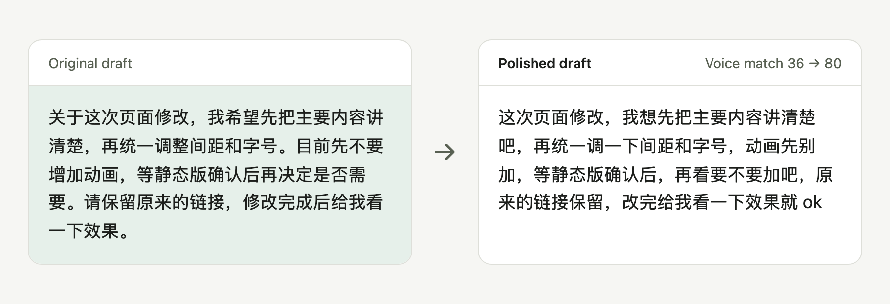
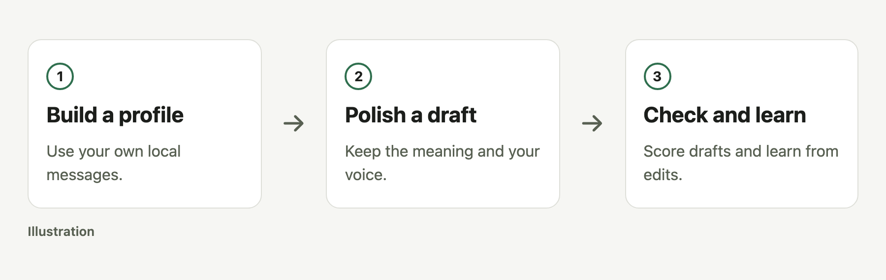

# style-polish

Let AI polish drafts in your own voice.

[简体中文](README.zh-CN.md) · [MIT](LICENSE)

<picture>
  <source media="(prefers-color-scheme: dark)" srcset="docs/readme/hero-dark.png">
  
</picture>

Agent-generated with the example profile; voice match = 100 minus profile-mismatch and banned-phrase penalties.

## Quick start

```sh
gh repo clone bmdy6/skill-style-polish .agents/skills/style-polish
```

Then tell your agent:

> Build my local style profile, then polish this draft in my voice.

Requires authenticated gh access to clone, Python 3.9+, and a skill-capable agent; standard library only.

For a local, automatic profile build (no agent review):

```sh
cd .agents/skills/style-polish
python3 scripts/run.py --no-llm
```

The default `python3 scripts/run.py` may pause for agent review. With no usable
messages it explains how to start and leaves existing profiles unchanged.
Profiles are saved to `~/.style-polish/spoken.md`; the pipeline runs the leak gate.
Local corpora stay in the ignored `corpus/` directory. Nothing is uploaded.

Works with **Claude Code**, **Codex**, **Cursor**, and **pi**. More adapters, formats, and limitations are in [compatibility](docs/compatibility.md).

## What you get

- **Privacy filtering.** Entities marked for review or redaction are filtered before profiling.
- **Personal style.** Profiles keep statistics and whitelisted language patterns.
- **Measurable feedback.** Draft checks score differences from the profile.

## How it works

<picture>
  <source media="(prefers-color-scheme: dark)" srcset="docs/readme/workflow-dark.png">
  
</picture>

## Options

| Option | Purpose |
|---|---|
| `--no-llm` | Redact review-band entities automatically. |
| `--profile-out` | Choose the local profile path. |
| `--leak-gate` | Check profiles for leaks. |

See the [usage reference](docs/reference.md).

## FAQ and boundaries

**Are chats uploaded?** Scripts process files locally; keep corpora and personal profiles out of commits.

**Does it work in English?** Profiles and checks currently focus on Chinese; English results need separate validation.

**Is the image real personal data?** No; an agent polished an original draft using the bundled synthetic profile.

**What was tested?** The core polish ran with the bundled example profile, then check.py scored it; this measures style habits, not editing quality. No real personal sessions were read.

**What does 36 → 80 mean?** check.py starts at 100 and deducts profile-mismatch and banned-phrase penalties; the rewrite still loses 20 for sentence length.

<details><summary>Privacy boundary</summary>

Process only your own authorized material and review filtering results. Automated checks cannot prove the absence of every privacy risk.

Collection keeps healthy messages when a record or source file is malformed. The summary includes `warnings_per_source` with error types and counts, without source paths or message text; nonempty warnings mean collection was incomplete. Cursor/OpenCode databases are read-only, including committed WAL data, without requesting a checkpoint.

</details>

## Contributing

Reproduce issues with synthetic data before submitting an issue or PR.

## License

[MIT](LICENSE).
