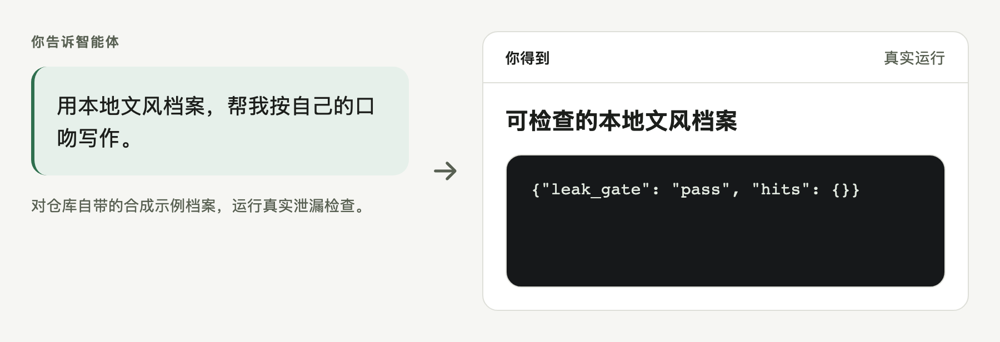
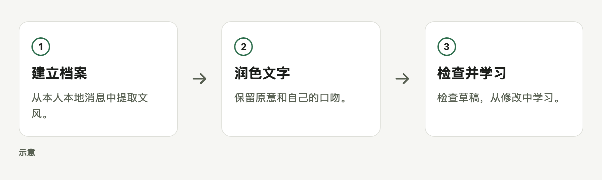

# style-polish

让 AI 用你自己的口吻润色文字。

[English](README.md) · [MIT](LICENSE)

<picture>
  <source media="(prefers-color-scheme: dark)" srcset="docs/readme/hero-dark.zh-CN.png">
  
</picture>

由 agent 用附带的示例档案生成；口吻匹配度 = 100 减去档案差异和禁用语扣分。

## 快速开始

```sh
gh repo clone bmdy6/skill-style-polish .agents/skills/style-polish
```

然后告诉智能体：

> 先建立本地文风档案，再按我的口吻润色这段草稿。

克隆需要 gh，运行需要 Python 3.9+ 和支持技能的智能体；脚本仅用标准库。

直接在本地自动建档（不经智能体审阅）：

```sh
cd .agents/skills/style-polish
python3 scripts/run.py --no-llm
```

默认的 `python3 scripts/run.py` 可能暂停并要求智能体审阅。没有可用消息时，
会提示如何开始，并保留已有档案。档案保存至 `~/.style-polish/spoken.md`，
流程会自动运行泄漏闸门。本地语料保留在已忽略的 `corpus/` 目录，不上传。

兼容 **Claude Code**、**Codex**、**Cursor** 和 **pi**；其他适配器、会话格式和限制见[兼容说明](docs/compatibility.md)。

## 你会得到什么

- **隐私过滤。** 建立档案前，先过滤待审或需脱敏的实体。
- **个人文风。** 档案保存统计量和白名单语言模式。
- **可量化的反馈。** 草稿检查会对照档案，为差异打分。

## 如何工作

<picture>
  <source media="(prefers-color-scheme: dark)" srcset="docs/readme/workflow-dark.zh-CN.png">
  
</picture>

## 选项

| 选项 | 用途 |
|---|---|
| `--no-llm` | 对待审实体默认脱敏。 |
| `--profile-out` | 选择本地档案路径。 |
| `--leak-gate` | 检查档案泄漏。 |

完整流程见[使用参考](docs/reference.md)。

## 常见问题和边界

**会上传聊天记录吗？** 脚本在本地处理，语料和档案不应提交。

**中英文都能用吗？** 当前档案和检查更偏向中文，英文效果需要单独验证。

**图里用的是真人数据吗？** 不是，agent 按合成示例档案润色了原创虚构草稿。

**已经完整测试了吗？** 已实跑示例润色并用 check.py 打分；分数只衡量文风统计，不代表改稿质量，未读取真实个人会话。

**36 → 80 是什么意思？** check.py 从 100 分扣除档案差异和禁用语扣分；图中示例因句长偏差扣了 20 分。

<details><summary>隐私边界</summary>

只处理有权使用的本人材料，过滤结果仍需审查；自动检查不能证明不存在所有隐私风险。

遇到坏记录或无法读取的来源文件，采集会保留其他正常消息继续处理。摘要的 `warnings_per_source` 只列错误类型和数量，不打印源路径或消息原文；非空表示本次采集不完整。Cursor/OpenCode 数据库以只读方式读取，包括已提交的 WAL 内容，不主动要求 checkpoint。

</details>

## 参与贡献

请用合成材料复现问题，再提交 issue 或 PR。

## 许可证

[MIT](LICENSE)。
