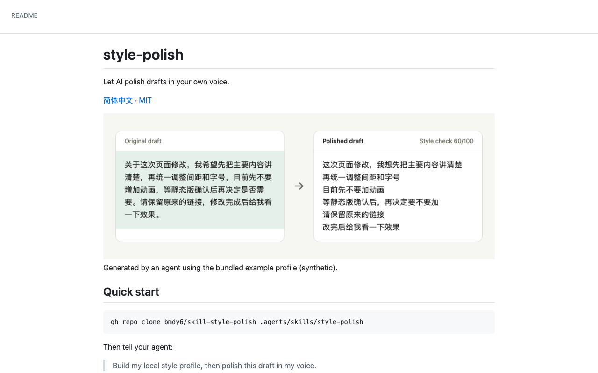
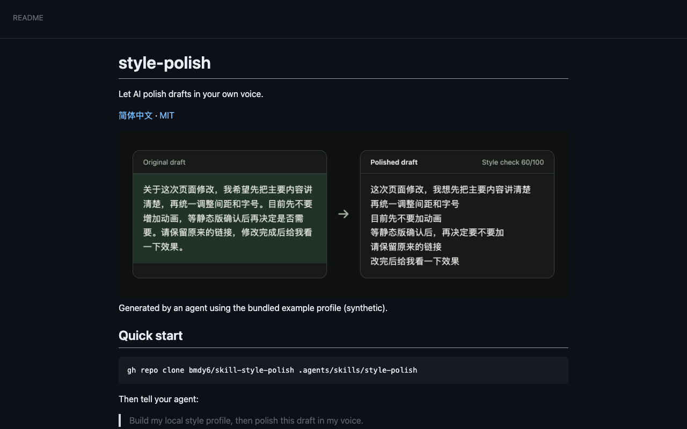
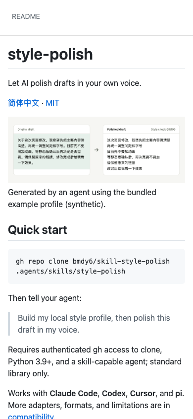
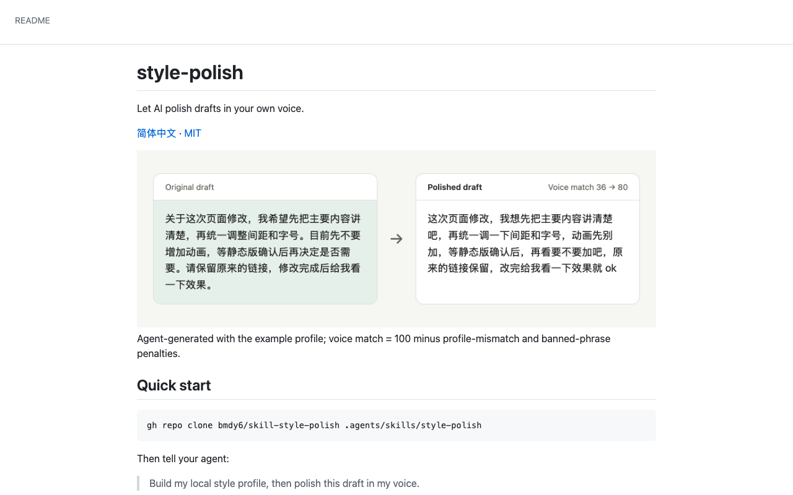
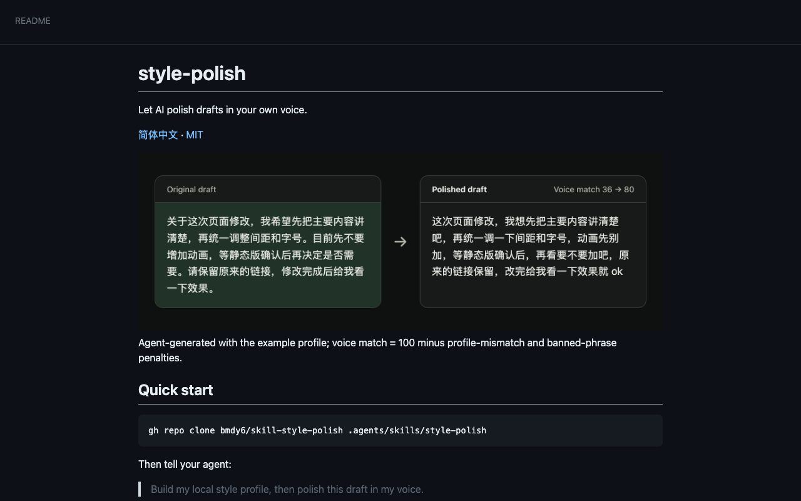
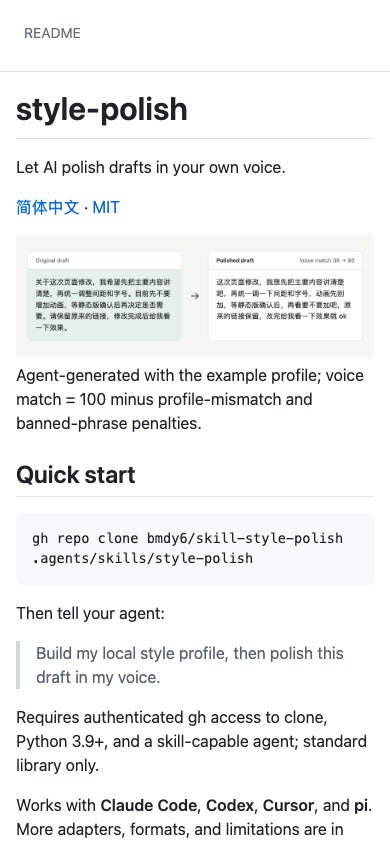

# README delivery

Before: 100/100. After: 100/100.

## Verification

| Check | Status | Evidence |
|---|---|---|
| V1 | pass | Passed |
| V2 | pass | Passed |
| V3 | pass | Passed |
| V4 | pass | Passed |
| V5 | pass | Passed |
| V6 | pass | Passed |
| V7 | pass | Passed |
| V8 | skip | No test command discovered |
| V9 | pass | Passed |
| V10 | pass | Passed |
| V11 | pass | Passed |

## Stranger

{
  "status": "fail",
  "checks": {
    "what": true,
    "forWhom": false,
    "firstCommand": true,
    "wouldTry": true,
    "whatOutput": true
  },
  "answers": {
    "what": "style-polish is an AI agent skill that rewrites drafts to sound more like you.",
    "forWhom": "People who use AI coding agents and want help polishing writing without losing their personal voice.",
    "firstCommand": "gh repo clone bmdy6/skill-style-polish .agents/skills/style-polish",
    "wouldTry": "yes",
    "why": "The before-and-after example makes the benefit concrete: more natural wording while keeping the original intent.",
    "whatOutput": "A rewritten draft in your voice. The example shows Chinese text becoming more conversational, alongside a voice-match score increasing from 36 to 80.",
    "mostAppealing": "Building a local style profile from my own writing instead of getting generic AI prose.",
    "confusing": [
      "Which agents support this skill, and what prerequisites are needed?",
      "How is my local style profile built, and what writing samples do I provide?",
      "Does normal output include the comparison cards and score, or are those only for this README example?",
      "The voice-match score measures profile mismatch and banned phrases, but it is unclear how reliably that reflects sounding like me."
    ]
  }
}

## Blind choice

{
  "status": "pass",
  "winner": "after",
  "answers": {
    "choice": "B",
    "why": "The rewrite feels more conversational, and the before-and-after voice score makes the benefit easier to grasp.",
    "confusing": [
      "I can’t tell how reliably the voice-match score reflects someone’s actual writing style."
    ]
  },
  "randomization": {
    "method": "crypto.randomInt(2)",
    "draw": 0
  },
  "labels": {
    "A": {
      "source": "before",
      "sha256": "e90f29942b0da00ca6c146e11a15ed14627a65e328bcee14e95b670f83b1e35e"
    },
    "B": {
      "source": "after",
      "sha256": "b56d0ee019bf035b455094643a4ef163d230c344a871f0fca6ca431bcb35e675"
    }
  }
}

## Images

- hero-light.png: real; self-check pass
- hero-dark.png: real; self-check pass
- hero-light.zh-CN.png: real; self-check pass
- hero-dark.zh-CN.png: real; self-check pass
- workflow-light.png: illustration; self-check pass
- workflow-dark.png: illustration; self-check pass
- workflow-light.zh-CN.png: illustration; self-check pass
- workflow-dark.zh-CN.png: illustration; self-check pass

## Gates

G1: agent. G2: agent.

{
  "G1": {
    "decidedBy": "agent",
    "originalTagline": "让 AI 用你自己的口吻润色文字：从你电脑上所有 AI agent 的聊天记录里学你怎么说话。",
    "candidates": [
      "让 AI 用你自己的口吻润色文字。",
      "把草稿改顺，留下你自己的口吻。",
      "从本地文风档案出发，润色你的中文草稿。"
    ],
    "adaptedFromOld": "让 AI 用你自己的口吻润色文字。",
    "choice": "让 AI 用你自己的口吻润色文字。",
    "reason": "Round 2 requires the project outcome and concrete output, with the useful original tagline preserved as a candidate."
  },
  "G2": {
    "decidedBy": "agent",
    "choice": "Approved after round 2 core-output and baseline comparison review",
    "reason": "Round 3: inspect the actual score comparison, calculation caption and light/dark first screens before delivery."
  }
}

## Intentional deletions

[
  {
    "id": "heading:README.md:和已有项目的区别",
    "reason": "Remove unverified named competitor comparisons; retain usage, privacy and all compatibility details in the linked compatibility document."
  }
]

## Not verified

- V8: skip; No test command discovered
- External links only checked when --online was requested.
- Renderer: github-api.
